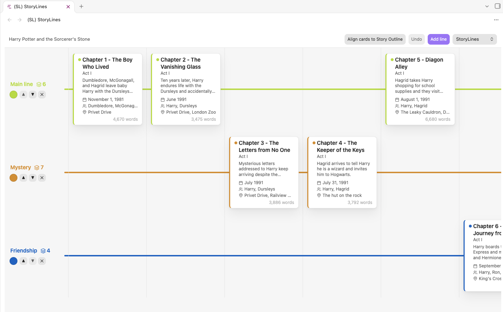
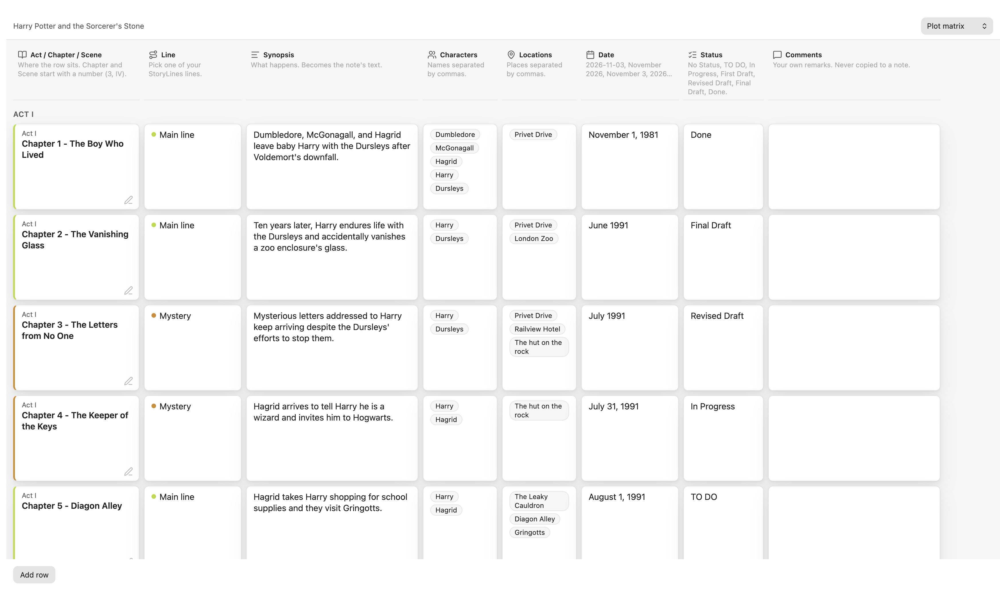
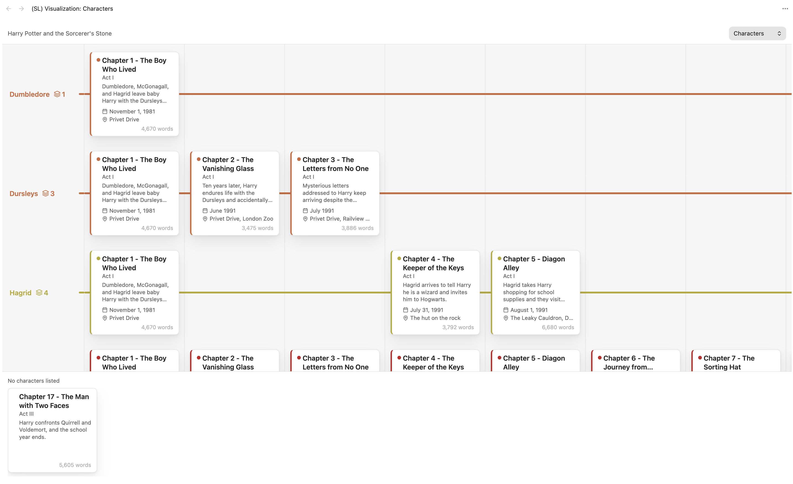
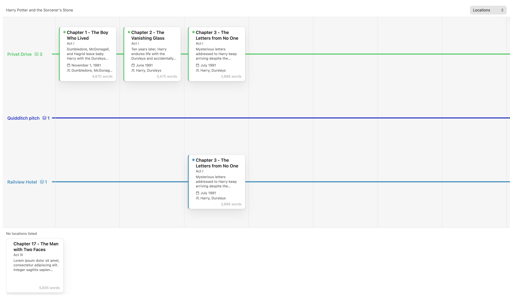
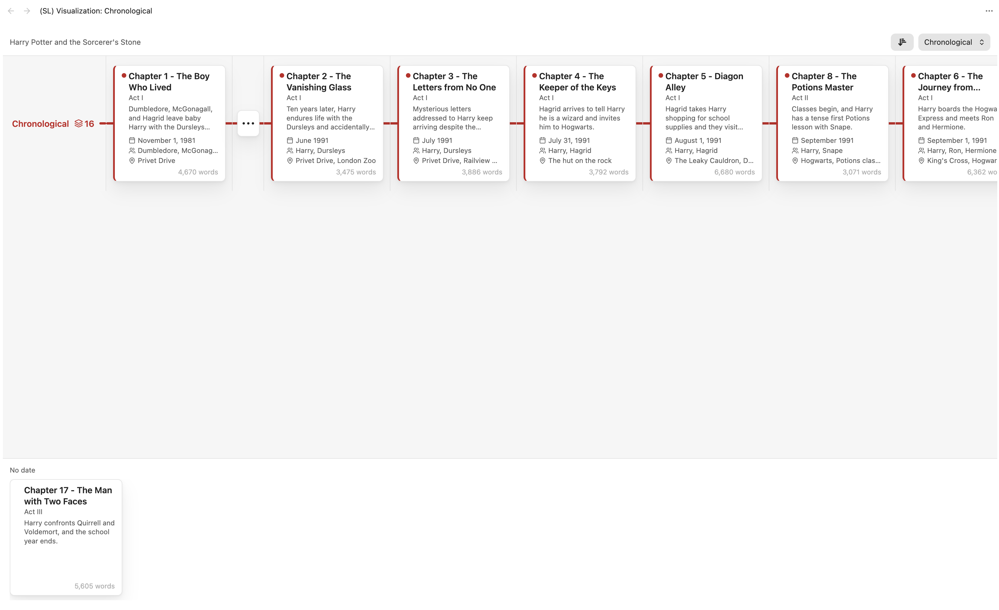
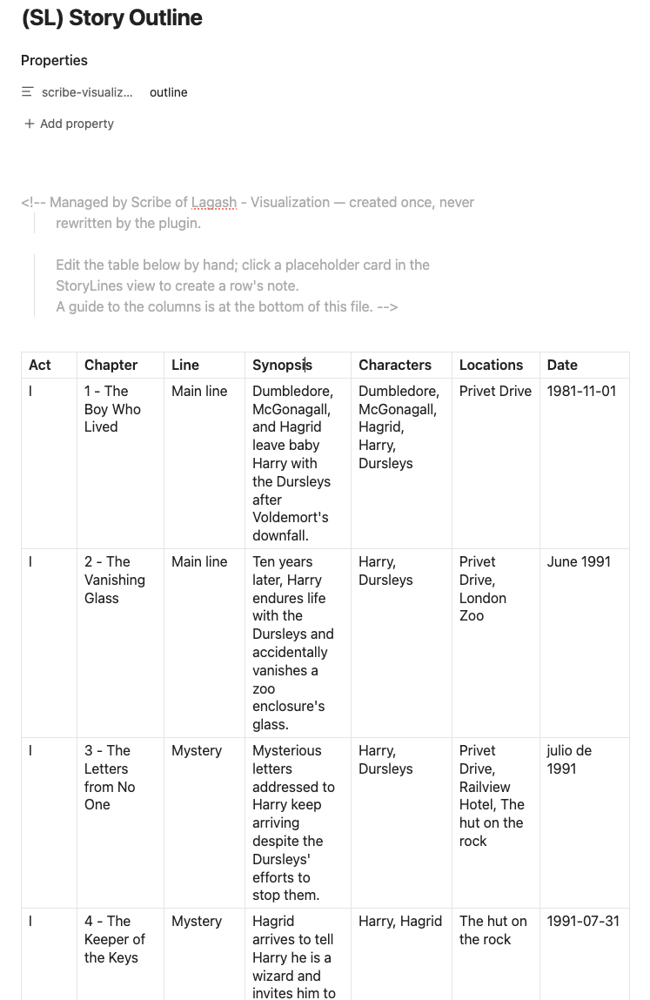

# Scribe of Lagash - Visualization


An [Obsidian](https://obsidian.md) plugin that helps writers **visualize** their
chapters and scenes and **plot** their story ahead of writing it. It is part of
the **Scribe of Lagash** series, a set of independent, focused tools for
planning and writing stories in Obsidian.

- **Visualize** what you have written and planned: see every chapter and scene as a card,
  arranged on your own lines, or grouped by character, location or in-story
  date.
- **Plot** what comes next: plan the story in a Story Outline, edit it as a
  matrix, and turn planned rows into real notes with a click.

This plugin doesn't own your prose: chapters and scenes are just regular notes
in your vault. Point the plugin at the folder that holds a story and it
recognizes chapters and scenes from their titles ("Chapter 1", "Scene II",
"Prologue", …); a few `scribe-note-*` properties are optional and
only needed to override the title or add detail. You can see the story in
several views: **StoryLines**, where you arrange the cards on your own lines;
the read-only **Characters**, **Locations** and **Chronological** views, which
group the same chapters and scenes by who appears, where they happen and when;
and the **Plot matrix**, the Story Outline as an editable table of squares. It never edits a note you
already wrote. What it does write is limited to: a per-story **StoryLines file**
that stores the lines and card positions of the StoryLines view; the optional
**Story Outline file**, created as an empty table when you ask for it (and
filled from your notes only if you run **Generate Story Outline from notes**
while it is still empty); and a new chapter or scene note when you click a
planned card from the outline; the Plot matrix also edits the cells of the Story Outline you
click. The Characters, Locations and Chronological views are derived
from your notes and save nothing.

## Thank you

If this plugin helps your writing, you can support its development
[buying me a coffee on Ko-fi](https://ko-fi.com/O3J528W3FZ)

<div align="left">

[](https://ko-fi.com/O3J528W3FZ)

</div>

## Installation

Requires Obsidian ≥1.10.0.

You can install it from the
[community plugins page](https://community.obsidian.md/plugins/scribe-of-lagash-visualization),
or download `main.js`, `manifest.json`, and `styles.css` from the
[latest release](https://github.com/aescanes/scribe-of-lagash-visualization/releases/latest)
and copy them into `<vault>/.obsidian/plugins/scribe-of-lagash-visualization/`.

## Scribe of Lagash Plugins

**Scribe of Lagash** is a series of independent, single-concern Obsidian
plugins for planning and writing stories:

- **[Scribe of Lagash - Visualization](https://community.obsidian.md/plugins/scribe-of-lagash-visualization)** ([github repository](https://github.com/aescanes/scribe-of-lagash-visualization)) —
  helps writers visualize their chapters and scenes.
- **[Scribe of Lagash - Goals and Stats](https://community.obsidian.md/plugins/scribe-of-lagash-goals-stats)** ([github repository](https://github.com/aescanes/scribe-of-lagash-goals-stats)) —
  helps writers set goals and see detailed statistics for their story.
- **[Scribe of Lagash - Focus](https://community.obsidian.md/plugins/scribe-of-lagash-focus)** ([github repository](https://github.com/aescanes/scribe-of-lagash-focus)) —
  helps writers focus on their work and remove distractions.

Each plugin works fine on its own, and none requires another, but they are
designed to complement each other and work best together.

### About the name

"Scribe" is the writer at the center of every plugin in the series, and
"Lagash" nods to _Nippur de Lagash_, the classic Argentine comic.

## Features

### StoryLines view

The plugin opens in a **Visualization** tab (ribbon icon / "Open visualizations"
command), and the tab's title names the view it is showing, e.g. "(SL)
Visualization: Plot matrix". StoryLines is its default view.
Horizontal, colored **lines** for a story, with each chapter/scene as a card
sitting on a line. Pick "Create lines" the first time to seed a "Main line",
then drag cards between lines or along the shared column grid — columns line
up across every line by reading order, and you can leave deliberate gaps
between cards. Dropping a card onto an occupied column nudges the others
right. When a Story Outline is set up, an **Align cards to Story Outline**
toolbar button snaps every card — real or planned — back to the outline's
reading order and onto the line its row names. Add /
rename / recolor / reorder / delete lines from the line headers. Changes save
to the StoryLines file (`StoryLines.md`) automatically; `Mod+Z` undoes.



### Plot matrix view

The Story Outline as a matrix of big squares, in the same look as the other
views: one row per outline row, and one column per piece of information —
**Act / Chapter / Scene** (one square), **Line**, **Synopsis**, **Characters**,
**Locations**, **Date**, **Status** and **Comments**. Rows are grouped under a heading for their Act and, for a scene, its Chapter,
with one row per chapter or scene. Rows whose note doesn't
exist yet are dashed, a line's color marks the left edge, and a ⚠ shows when a
row disagrees with the real note — in the cell it is about: the **Line** cell for
a line that is unknown or placed elsewhere, **Characters**, **Locations**,
**Date** or **Status** when the note's property differs (or the row leaves it
empty while the note has it), and the first square for the folder or type.
Hover the ⚠ to read why.

Unlike the other views it is editable, and what it edits is the **Story Outline
file**: click a square to change that cell of the table (Enter or clicking away
saves, Escape cancels). The pencil on the first square edits the Act, Chapter
and Scene cells; **Add row** appends an empty row (use the pencil to give it an Act, Chapter or
Scene; until it has a Chapter or Scene it shows as "Not numbered yet" and the
other views ignore it), and a row with no note yet has a **Create note** link
in its first square. The toolbar's **Create N planned notes** button (the same as
in StoryLines) creates all of them at once. Only the cell you edit
is rewritten, and an edit is refused if the table changed in the meantime.
Notes, `Lines.md` and every other row stay as they are.

A short line under each column title says what goes there. **Status** is a
picker: No Status (an empty cell), TO DO, In Progress, First Draft, Revised
Draft, Final Draft or Done. If you type something else into the table, it is
left as you wrote it and shown with a ⚠ instead of being treated as a status.

Without a Story Outline file the matrix is read-only and built from your notes
(their titles, `scribe-note-*` properties, line placement and first paragraph,
shown under Synopsis; the Comments column is left out). There is one row per
note, grouped under a heading for each of its folders (an act folder, then a
chapter folder), exactly as you named them and in any language; notes that
aren't in folders are not grouped. `Comments` is yours alone: it lives only in
the outline table and is
never copied into a note.



### Characters view

The combo box at the top right of the Visualization tab
switches between the different views. Characters keeps the same
look but is read-only: one line per character (alphabetical), each showing
the chapters/scenes that name them in reading order, so a scene with two
characters appears on both lines. Names come from the notes'
`scribe-note-characters` property and the Story Outline's `Characters`
column; the outline's names win, and the note's are used when the row lists
none. If a note and its outline row list different characters a ⚠
explains the difference. Planned (not yet written) rows show as dashed,
non-clickable cards, and notes with no characters sit in a "No characters
listed" strip. Nothing is moved, created or saved in this view, and each tab
remembers its own view.



### Locations view

The same read-only view, with one line per location.
Names come from the notes' `scribe-note-locations` property and the Story
Outline's `Locations` column, with the same rule (outline first, then the note;
⚠ when they differ; a
"No locations listed" strip for the rest).



### Chronological view

The same read-only view, with a single line that orders every chapter and
scene by its in-story date. The date comes from the note's `scribe-note-date`
property or the Story Outline's `Date` column (if both exist the outline wins,
and a ⚠ explains a difference). The button next to the combo box switches
between oldest first and newest first. Scenes with the same date keep their
chapter/scene order; notes with no date, or a date that isn't recognized (⚠),
sit in a "No date" strip. When two neighbouring cards are much further apart in time than usual (more
than twice the average gap), a bold **…** marker takes a narrow slot between them; hover
it to see how long passed (for example "about 10 years later").
Cards in every view show a readable date (`November 3, 2026`)
whatever form you typed (in the **Title language**); the notes are never rewritten.

Accepted dates (English and Spanish month names, full names only):

| Form                     | Examples                                                        |
| ------------------------ | --------------------------------------------------------------- |
| Year / month / day (ISO) | `2026`, `2026-11`, `2026-11-03`                                 |
| Month and year           | `November 2026`, `noviembre de 2026`                            |
| Day, month and year      | `November 3, 2026`, `3 November 2026`, `3 de noviembre de 2026` |

A month followed by a single number is always a **year**, so a story without a
real calendar can use small made-up years: `November 1`, `December 1`,
`January 2` are November and December of year 1, then January of year 2. A day
needs a year too (`November 3, 1`). A bare month, `03/01/2026`, abbreviations
and impossible dates (`2026-02-30`) are not recognized. Real and made-up years
in the same story simply sort by number.

> **Tip: if Obsidian shows a calendar picker for `scribe-note-date`**, it has
> given that property the _Date_ type, which only takes real `YYYY-MM-DD` dates.
> To type any of the forms above (like `November 1`), change the type to _Text_:
> in the note's **Properties** panel, click the icon to the left of
> `scribe-note-date`, choose **Property type**, then **Text**. Obsidian
> remembers it for every note in the vault. The Story Outline's `Date` column
> is a plain table cell and has no such picker.



### Story Outline file _(optional)_

Name a file under **Story Outline file
name** in settings and click **Create**; it's written as an empty
Markdown table (Act / Chapter / Scene / Line / Synopsis / Characters / Locations). The `.md` extension
is optional — `Outline` and `Outline.md` both create `(SL) Outline.md`. Fill
it in to plan the story before the
notes exist: rows with no matching note appear as dashed placeholder cards
on the StoryLines view, and clicking one creates the note (title, Synopsis,
properties) on that line. Once a note exists its Synopsis shows on the
card; a row that disagrees with the real note/folder gets a ⚠ marker — the
files always win.
The optional `Characters` and `Locations` columns (comma-separated names)
feed the **Characters** and **Locations views**, including for notes not written yet.
If you already have notes, the **Generate Story Outline from notes** command
fills an empty outline from them; see
[Generating the Story Outline from your notes](#generating-the-story-outline-from-your-notes). See
[docs/feature-plans/outline-file-plan.md](docs/feature-plans/outline-file-plan.md).



### What a card shows

A card shows its title, folder breadcrumb, a short text, then the date, the
characters and the locations (each on its own line, with a small icon), and
the word count.

The date, characters and locations follow one rule everywhere in the plugin:
the **Story Outline row first**, then the **note**, then nothing. If you keep a
Story Outline, its row is the source of truth; if you write without one (or a
row leaves the field empty), the note's `scribe-note-date`,
`scribe-note-characters` and `scribe-note-locations` properties are used. When
both have a value and they differ, the outline's is shown and a ⚠ explains the
difference. A ⚠ also appears when the outline has a row for the note but leaves
the field empty while the note has a value (the note's value is shown). A note
with no outline row never gets this warning. Planned cards show their row's. The Characters and Locations views leave their own field off the cards, since the
lines already say it.

The short text is the Story Outline's Synopsis; a note whose row has none shows
the first paragraph of the note instead.

## Setting up a story

In the plugin settings, add the vault-relative folder that holds your story's
notes under **Story folder**. The
plugin scans that folder and classifies each note by its **title**:

| Title looks like                               | Recognized as             |
| ---------------------------------------------- | ------------------------- |
| `Chapter 1`, `Chapter IV`, `Ch. 12 — The Fall` | chapter (number 1, 4, 12) |
| `Scene 2`, `Scene IX`                          | scene                     |
| `Prologue`, `Epilogue`, `Interlude`            | chapter (no number)       |
| anything else                                  | ignored                   |

Leave **Story folder** empty to scan the whole vault instead.

### Recognized title words

The **Title language** setting picks which language's words the plugin looks for
at the **start** of a note's title. The number may be digits or a roman numeral
(`IV`), an optional `.` can follow the keyword, and matching is
case-insensitive. English (`en`) and Spanish (`es`) ship today:

| Meaning                                                                                      | English                                                                 | Español                                                    |
| -------------------------------------------------------------------------------------------- | ----------------------------------------------------------------------- | ---------------------------------------------------------- |
| Chapter _N_                                                                                  | `Chapter N`, `Chap N`, `Ch N`                                           | `Capítulo N`, `Capitulo N`, `Cap N`                        |
| Scene _N_                                                                                    | `Scene N`, `Sc N`                                                       | `Escena N`, `Esc N`                                        |
| Chapter, no number                                                                           | `Prologue`, `Epilogue`, `Interlude`, `Foreword`, `Afterword`, `Preface` | `Prólogo`, `Epílogo`, `Interludio`, `Prefacio`, `Epígrafe` |
| Act folder — the word the Story Outline file prepends to an `Act` cell when it builds a path | `Act`                                                                   | `Acto`                                                     |

So with **Title language** set to Español, `Cap. 3 — La caída` is chapter 3 and
`Escena II` is scene 2. Adding a language is one more pattern table in
[`src/data/titleParser.ts`](src/data/titleParser.ts) — nothing else changes.

### Story structure

A note's place in the manuscript comes from **where it sits in folders**, not
from properties. Any of these layouts works — but pick **one per story**:

| Layout                        | On disk (under the story folder)                                       |
| ----------------------------- | ---------------------------------------------------------------------- |
| Chapters as files             | `Chapter 1.md`, `Chapter 2.md`, …                                      |
| …grouped in acts              | `Act I/Chapter 1.md`, `Act II/Chapter 5.md`, …                         |
| Chapters as folders of scenes | `Chapter 1/Scene 1.md`, `Chapter 1/Scene 2.md`, …                      |
| …grouped in acts              | `Act I/Chapter 1/Scene 1.md`, …                                        |
| Scenes with no chapter        | `Scene 1.md`, or `Act I/Scene 1.md`                                    |
| Deeper nesting                | `Act I/Part 2/Chapter 3.md` — every folder just adds to the breadcrumb |

A scene's chapter is simply its containing folder — there is no `parent` key.
`Prologue.md` / `Epilogue.md` / `Interlude.md` can go anywhere; having no number,
they sort after the numbered notes in the same folder.

> **Don't mix "chapter as a file" and "chapter as a folder" in the same story.**
> If you do, every file-chapter sorts before any folder-chapter's scenes. Pick
> one style and convert the whole story to it.

Manuscript order is then: folder path first (all of `Act I/…` before `Act II/…`;
a numbered folder sorts by its number, so `Chapter 2/` comes before
`Chapter 10/`), then the number in the title, then the title text. Sub-folders
also show as a breadcrumb under each card — a note at
`My Story/Act I/Chapter I/Scene 1.md` (story folder `My Story`) shows "Scene 1"
with "Act I - Chapter I" underneath.

### Planning ahead with the Story Outline file

Set **Story Outline file name** in settings (the `.md` is optional — `Outline`
and `Outline.md` both mean `(SL) Outline.md`) and click **Create**. The
plugin writes one `(SL) <name>.md` per story folder with an empty table and a
column guide.

When you plan a story in the **Story Outline file** table before writing the
notes, fill the columns that match your layout:

| Layout                    | Columns to fill             | The row's note               |
| ------------------------- | --------------------------- | ---------------------------- |
| Chapters as files         | `Chapter`                   | `Chapter 1.md`               |
| …grouped in acts          | `Act` + `Chapter`           | `Act I/Chapter 1.md`         |
| Scenes in chapter folders | `Chapter` + `Scene`         | `Chapter 1/Scene 2.md`       |
| …grouped in acts          | `Act` + `Chapter` + `Scene` | `Act I/Chapter 1/Scene 2.md` |
| Scenes with no chapter    | `Scene` (+ optional `Act`)  | `Scene 2.md`                 |

Numbers may be digits or roman numerals, optionally followed by free text —
e.g. a `Chapter` cell of `1 - The beginning` plans `Chapter 1 - The beginning.md`,
the same as if you'd typed that title directly. The `Act` / `Chapter` / `Scene`
words and folder names follow the **Title language** setting. `Line` is a line
name or id from the StoryLines file; `Synopsis` shows on the card and becomes
the note body when you create it. `Status` and `Comments` are for your own
bookkeeping; `Comments` stays in the table and is never copied into a note.

A new outline file asks Obsidian to show it at the full width of the pane (a
`cssclasses: [scribe-outline-wide]` line in its properties), so the table can
show more columns without scrolling. An outline you created earlier gets the
same line added to its properties the next time the plugin reads it (any
`cssclasses` you already had are kept).

The outline always has every column (`Act`, `Chapter`, `Scene`, `Line`,
`Synopsis`, `Characters`, `Locations`, `Date`, `Status`, `Comments`): when the
plugin reads the file and one is missing, it adds it in its usual place (for
example `Scene` right after `Chapter`). Existing columns and your text are never changed, and a column you
delete comes back the next time the file is read.

List the people in a chapters/scenes under `Characters`
(comma-separated, e.g. `Harry, Ron, Hermione`) to enable the **Characters view**:
each name becomes a line showing the chapters/scenes it appears in. `Locations`
does the same for the **Locations view**. Add a `Date` column (see the
[Chronological view](#chronological-view) for the accepted forms) to place
planned rows on the **Chronological view**.

A row with neither a `Chapter` nor a `Scene`
value is ignored, and un-numbered units (`Prologue`, …) can't be planned here —
create those notes directly. The Story Outline file created for you repeats
this guide below the table.

### Generating the Story Outline from your notes

Already have chapters and scenes written? Instead of typing the outline by
hand, run the **Generate Story Outline from notes** command from the command
palette. It builds the table from the notes the plugin already recognizes in
your story folder, so you can start planning from what exists.

Before you run it, set **Story Outline file name** in settings (the command
asks you to if you haven't). You don't need to click **Create** first: if the
file doesn't exist yet, the command creates it. Then, for each recognized
chapter or scene note, it writes one row:

| Column                                      | What the command fills in                                                                                            |
| ------------------------------------------- | -------------------------------------------------------------------------------------------------------------------- |
| `Act`                                       | The act folder the note sits in, e.g. `I` for `Act I/` (empty for a note outside an act folder)                      |
| `Chapter`                                   | The chapter number (for a scene, read from its chapter folder's name)                                                |
| `Scene`                                     | The scene number, for scene notes                                                                                    |
| `Line`                                      | The line the note's card sits on in the StoryLines file; a note not placed yet gets the topmost line                 |
| `Characters`, `Locations`, `Date`, `Status` | The note's `scribe-note-characters`, `scribe-note-locations`, `scribe-note-date` and `scribe-note-status` properties |
| `Synopsis`, `Comments`                      | Left empty for you to fill in                                                                                        |

Things to know:

- **It never overwrites your work.** It only fills an outline whose table has no
  rows yet. If the file already has any row, the command leaves it untouched and
  tells you so. To regenerate, empty the table first.
- **Un-numbered notes are skipped.** `Prologue`, `Epilogue` and the like have no
  number, so the table can't represent them; the notice tells you how many were
  skipped.
- **The generated table has every outline column.** It replaces the empty
  starter table. Any text around the table, such as the column guide, is kept.
- **Only `Act I`-style folders fill `Act`.** A folder with another name (say
  `Part 1/`) has no Act cell to live in, so that row can show a ⚠ saying the
  outline expects a different folder.
- **It doesn't change your notes or the StoryLines file.** Because every row
  matches a note that already exists, the outline shows no placeholder cards
  until you add new rows.

### Optional properties

None of this is required — it only adds detail the cards can show. They are
ordinary note properties (the YAML block at the top of the note):

```yaml
---
scribe-note-date: 1901-03-04 # in-story date, any free-form string
scribe-note-characters: [Alice, Bob]
scribe-note-locations: [Riverside Tavern]
scribe-note-status: draft
---
```

## Development

```bash
npm install
npm run prepare  # activate the Husky pre-commit hook (once; npm install skips it because ignore-scripts=true)
npm run dev    # watch build, outputs main.js
npm run build  # type-check + production build
npm test       # unit tests (Node's built-in runner; no test framework dependency)
npm run validate # typecheck + test + lint + lint:css (run before every commit)
```

### Supply-chain safety

- Every dependency in `package.json` is pinned to an exact version — no `^`/`~`
  ranges and no `latest`. `.npmrc` sets `save-exact=true` so future
  `npm install <pkg>` additions stay pinned by default.
- `.npmrc` also sets `ignore-scripts=true`, so `npm install`/`npm ci` never
  runs a dependency's `preinstall`/`install`/`postinstall` script
  automatically. The only dependency that ships one is `esbuild`, and its
  script just optimizes linking its already-installed platform binary — the
  build works fine without it. On the rare platform where it doesn't (e.g. an
  environment without a matching prebuilt `@esbuild/*` package), run
  `npm run rebuild:esbuild` to explicitly and visibly opt that one script back
  in for that single command.

To try the plugin in a vault, copy (or symlink) `manifest.json`, `main.js`,
and `styles.css` into `<vault>/.obsidian/plugins/scribe-of-lagash-visualization/`,
then enable it from Obsidian's Community Plugins settings.

## Contributing

Found a bug, or have a feature request? Open one on the
[GitHub Issues page](https://github.com/aescanes/scribe-of-lagash-visualization/issues) —
there's a template for each.

Contributions are welcome — see [CONTRIBUTING.md](CONTRIBUTING.md) for dev setup, code conventions, and the PR
process. This project follows a [Code of Conduct](CODE_OF_CONDUCT.md).

Found a security issue? See [SECURITY.md](SECURITY.md) instead of opening a public
issue.

See [CHANGELOG.md](CHANGELOG.md) for release history.

## License

[MIT](LICENSE).
